

### Engineering student building the whole stack from scratch: silicon-level kernels, flight control, robots, GPUs, distributed systems.

Every project below implements its core algorithms by hand, ships with tests and green CI,
and says plainly in its README what has been verified on real hardware and what is still simulated.

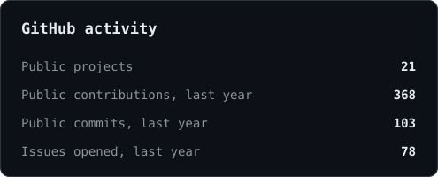
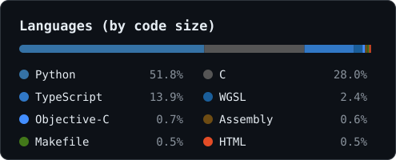

---

### 🌐 Try in your browser

<table>
<tr>
<td width="50%" valign="top">
<a href="https://github.com/coopersimpson101-debug/flipgpu">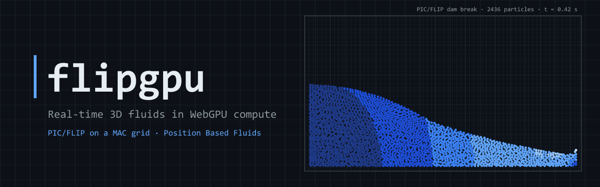</a>
<b><a href="https://github.com/coopersimpson101-debug/flipgpu">flipgpu</a></b>: real-time 3D PIC/FLIP and PBF fluids in WebGPU compute shaders. 128k particles, hand-written pressure solver. 
<a href="https://coopersimpson101-debug.github.io/flipgpu/"><b>▶ Live demo</b></a>
</td>
<td width="50%" valign="top">
<a href="https://github.com/coopersimpson101-debug/splatweb">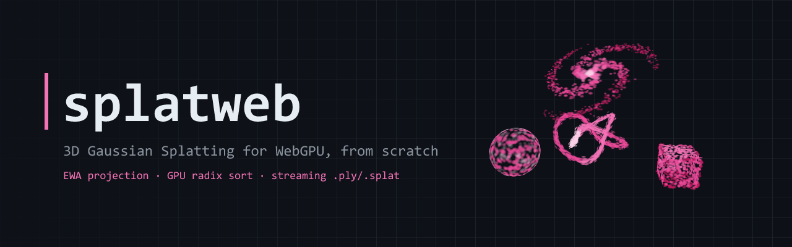</a>
<b><a href="https://github.com/coopersimpson101-debug/splatweb">splatweb</a></b>: Gaussian splatting renderer in WebGPU. EWA projection, GPU radix sort, streaming .ply/.splat loading. 
<a href="https://coopersimpson101-debug.github.io/splatweb/"><b>▶ Live demo</b></a>
</td>
</tr>
</table>

### 🤖 Robotics & embedded

<table>
<tr>
<td width="50%" valign="top">
<a href="https://github.com/coopersimpson101-debug/skyforge-fc">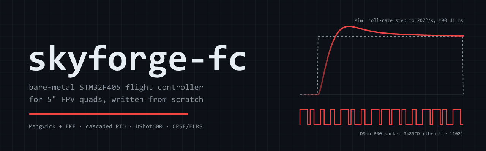</a>
<b><a href="https://github.com/coopersimpson101-debug/skyforge-fc">skyforge-fc</a></b>: bare-metal STM32F405 flight controller firmware. Madgwick + EKF fusion, cascaded PID, DShot600 over DMA, CRSF.
</td>
<td width="50%" valign="top">
<a href="https://github.com/coopersimpson101-debug/dog2real">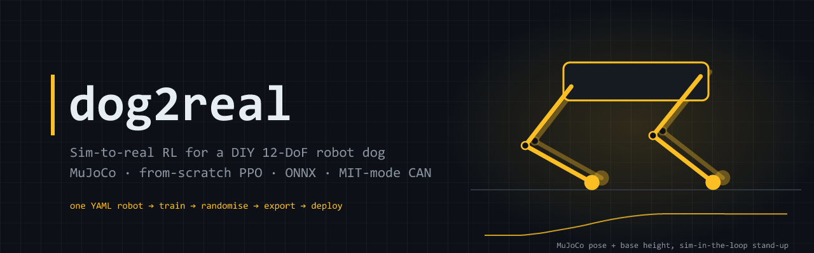</a>
<b><a href="https://github.com/coopersimpson101-debug/dog2real">dog2real</a></b>: sim-to-real RL for a 12-DoF quadruped. MuJoCo env, PPO from scratch, domain randomisation; the trained policy walks in sim.
</td>
</tr>
<tr>
<td width="50%" valign="top">
<a href="https://github.com/coopersimpson101-debug/insight-vio">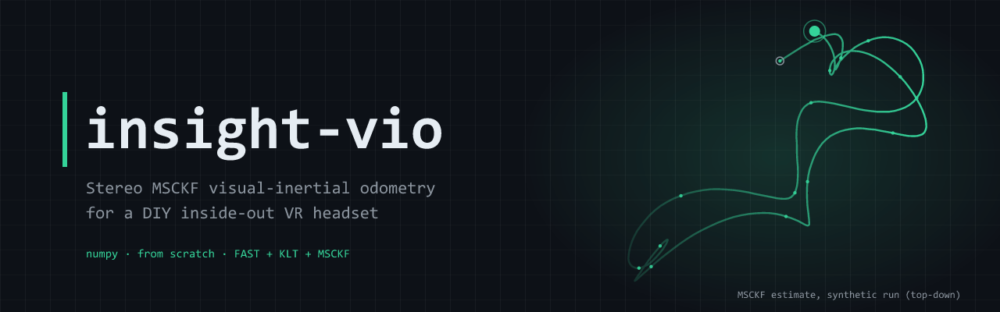</a>
<b><a href="https://github.com/coopersimpson101-debug/insight-vio">insight-vio</a></b>: inside-out 6DoF tracking for a DIY VR headset. MSCKF visual-inertial odometry, 0.5 cm ATE on synthetic stereo.
</td>
<td width="50%" valign="top">
<a href="https://github.com/coopersimpson101-debug/meshfind">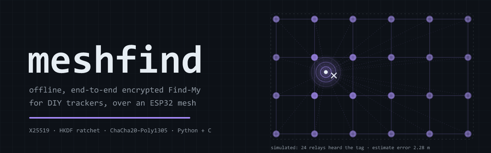</a>
<b><a href="https://github.com/coopersimpson101-debug/meshfind">meshfind</a></b>: offline, end-to-end encrypted Find My network. Rotating X25519 tags, ECIES reports, ESP32 ESP-NOW mesh.
</td>
</tr>
</table>

### ⚙️ Systems

<table>
<tr>
<td width="50%" valign="top">
<a href="https://github.com/coopersimpson101-debug/tinyinfer">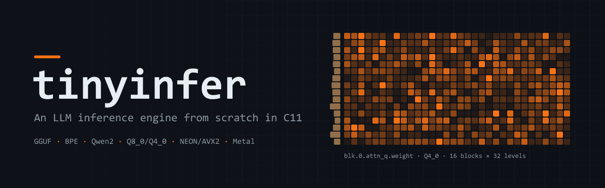</a>
<b><a href="https://github.com/coopersimpson101-debug/tinyinfer">tinyinfer</a></b>: LLM inference engine in dependency-free C + Metal. GGUF, BPE tokenizer, KV cache, Q4_0/Q8_0, NEON/AVX2 kernels.
</td>
<td width="50%" valign="top">
<a href="https://github.com/coopersimpson101-debug/orbit-os">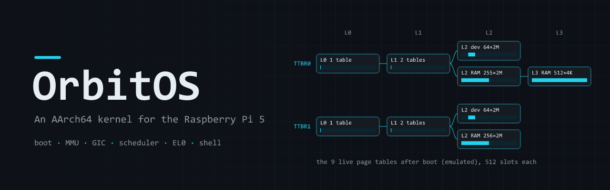</a>
<b><a href="https://github.com/coopersimpson101-debug/orbit-os">orbit-os</a></b>: AArch64 kernel for the Raspberry Pi 5, and the foundation for a phone and smartwatch OS. Chainloader, MMU, buddy allocator, preemptive scheduler, shell.
</td>
</tr>
<tr>
<td width="50%" valign="top">
<a href="https://github.com/coopersimpson101-debug/raftstore">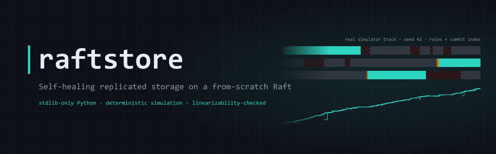</a>
<b><a href="https://github.com/coopersimpson101-debug/raftstore">raftstore</a></b>: self-healing replicated storage on Raft, from scratch. 6.4M simulated steps checked against the safety invariants, and drive pulls at every write boundary.
</td>
<td width="50%" valign="top">
<a href="https://github.com/coopersimpson101-debug/aegis-mcp">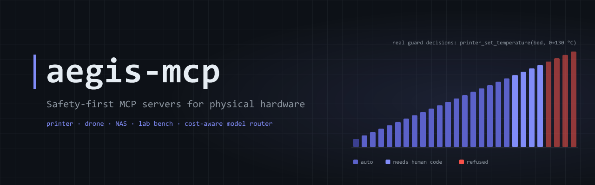</a>
<b><a href="https://github.com/coopersimpson101-debug/aegis-mcp">aegis-mcp</a></b>: MCP servers for physical hardware (3D printer, drone, NAS, lab) with a human-in-the-loop safety layer and a cost-aware model router.
</td>
</tr>
</table>

---

Each repo has a Status table: ✅ tested · 🧪 simulated · ⏳ awaiting hardware. Hardware demos and benchmarks are added as they're recorded.

<picture>
  <source media="(prefers-color-scheme: dark)" srcset="https://raw.githubusercontent.com/coopersimpson101-debug/coopersimpson101-debug/output/snake-dark.svg">
  
</picture>
 Stat cards and snake regenerate daily via <a href=".github/workflows/profile.yml">GitHub Actions</a>, using only public data.

